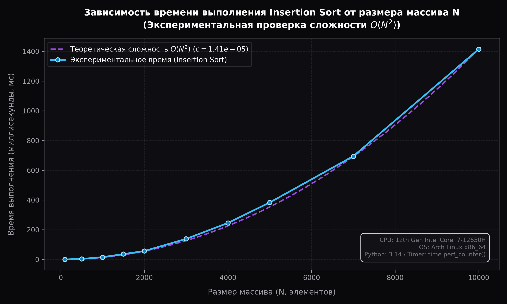

# Лабораторная работа № 6: Алгоритмы сортировки и бинарного поиска

[](https://www.python.org/downloads/)
[](https://opensource.org/licenses/MIT)
[]()
[]()

> **Дисциплина:** Программирование и прототипирование ИТ-решений  
> **Направление подготовки:** 09.03.03 Прикладная информатика (Бизнес и системная аналитика)  
> **Студент:** Мусин Тимур Булатович  
> **Группа:** БЦШ02-26-02  
> **Вариант:** Б (исследовательская траектория), **N = 17**  

---

## 1. Описание проекта

Данный репозиторий содержит программную реализацию и комплексное экспериментальное исследование алгоритмов **сортировки вставками** (*Insertion Sort*) и **итеративного бинарного поиска** (*Binary Search*), а также их модификаций (`lower_bound`, `upper_bound`, `linear_search`).

Все алгоритмы реализованы на **чистом Python без использования стандартных функций** `sorted()`, `list.sort()` или `bisect` (встроенная функция `sorted()` используется исключительно как эталон для контроля корректности в тестах).

### Ключевые особенности:
1. **Сохранение исходных данных:** функция `insertion_sort(values)` создает независимую копию `values[:]`, предотвращая мутацию входных данных.
2. **Воспроизводимость экспериментов:** генерация случайных наборов данных зафиксирована через `random.Random(42)`.
3. **Высокоточные замеры:** использование `time.perf_counter()` без учета накладных расходов ввода/вывода, не менее 3 повторов для каждого замера с расчетом среднего, min, max и стандартного отклонения.
4. **Реализация всех 7 обязательных исследовательских упражнений:** ручные трассировки, формальное доказательство инварианта цикла, обработка повторов, демонстрация сбоя на несортированном массиве и построение графика зависимости времени от $N^2$.

---

## 2. Структура проекта

```text
lab6_sort_search/
├── main.py                     # Базовый исполняемый модуль (Вариант А)
├── algorithms.py               # Библиотека алгоритмов (сортировка, бинарный/линейный поиск, границы)
├── benchmarks.py               # Комплексный бенчмарк (исследование на разных типах данных и N)
├── plot_generator.py           # Построение графика O(N^2) с оформлением High-Craft Dark UI
├── plot_complexity.png         # График зависимости времени от размера массива N
├── exercises/
│   └── run_all_exercises.py    # Решение и автоматическая валидация всех 7 упражнений
├── benchmark_results.json      # Зафиксированные численные результаты эксперимента
├── README.md                   # Документация репозитория
├── REPORT.md                   # Полный академический отчёт по лабораторной работе
└── Отчет_ЛР6_Мусин_ТБ_вар17.docx # Скомпилированный чистовой отчёт для сдачи
```

---

## 3. Математические модели и теоретическая сложность

### 3.1. Сортировка вставками (Insertion Sort)
Рассматривает левую часть массива как уже упорядоченную. На шаге $i$ элемент $key = A[i]$ вставляется на подходящее место среди $A[0..i-1]$ путем сдвига больших элементов вправо.

| Случай | Условие входа | Число сравнений / сдвигов | Временная сложность | Доп. память |
| :--- | :--- | :--- | :--- | :--- |
| **Лучший** | Массив уже отсортирован ($A[i] \le A[i+1]$) | $\approx N - 1$ | $O(N)$ | $O(N)$ (копия) |
| **Средний** | Случайное распределение элементов | $\approx \frac{N^2}{4}$ | $O(N^2)$ | $O(N)$ (копия) |
| **Худший** | Обратный порядок ($A[i] \ge A[i+1]$) | $\approx \frac{N^2}{2}$ | $O(N^2)$ | $O(N)$ (копия) |

### 3.2. Бинарный поиск (Binary Search)
Работает методом деления пополам на отсортированном массиве. На каждом шаге область поиска сужается ровно в 2 раза.

| Случай | Условие входа | Количество шагов | Временная сложность | Доп. память |
| :--- | :--- | :--- | :--- | :--- |
| **Лучший** | Искомый элемент находится строго в центре | $1$ | $O(1)$ | $O(1)$ |
| **Средний** | Случайный элемент из массива | $\le \log_2 N$ | $O(\log N)$ | $O(1)$ |
| **Худший** | Элемент на краю или отсутствует в массиве | $\lfloor\log_2 N\rfloor + 1$ | $O(\log N)$ | $O(1)$ |

---

## 4. Результаты экспериментальных измерений

> **Оборудование:** 12th Gen Intel(R) Core(TM) i7-12650H @ 4.70 GHz (10 ядер / 16 потоков)  
> **Окружение:** Arch Linux x86_64, Python 3.14.8  
> **Таймер:** `time.perf_counter()`, усреднение по 3 независимым прогонам (min – max)  

### 4.1. Основная таблица экспериментов (Раздел 9 методички)

| $N$ | Тип данных | Insertion Sort, мс (среднее [min – max]) | sorted(), мс | Binary Search (1000 запросов), мс | Теоретический и практический вывод |
| :---: | :--- | :---: | :---: | :---: | :--- |
| **100** | Случайный | **0.109** [0.103 – 0.113] | 0.008 | 0.377 | На малых $N$ накладные расходы интерпретатора сопоставимы |
| **1 000** | Случайный | **11.276** [10.377 – 12.252] | 0.099 | 0.769 | Время выросло в 103 раза при росте $N$ в 10 раз ($N^2$) |
| **5 000** | Случайный | **301.581** [287.009 – 312.962] | 0.482 | 0.828 | Рост в 26.7 раз при увеличении $N$ в 5 раз ($5^2 = 25$) |
| **10 000** | Случайный | **1 187.911** [1147.680 – 1239.943] | 1.230 | 0.955 | Время перевалило за 1 сек; Timsort быстрее почти в 1000 раз |
| **1 000** | Отсортированный | **0.094** [0.079 – 0.119] | 0.004 | 0.873 | **Лучший случай $O(N)$:** 0 сдвигов, быстрее случайного в **120 раз** |
| **1 000** | Обратный | **19.898** [18.444 – 21.032] | 0.005 | 0.787 | **Худший случай $O(N^2)$:** максимум сдвигов, в 1.8 раза дольше случайного |
| **1 000** | С повторами | **8.874** [8.366 – 9.221] | 0.061 | 0.255 | Стабильность алгоритма сохраняется, сдвигов меньше среднего |

---

### 4.2. Сравнение линейного и бинарного поиска (Раздел 7.2)
Серия из **1 000 поисковых запросов** к отсортированному массиву:

| Размер массива $N$ | Линейный поиск $O(N)$, мс | Бинарный поиск $O(\log N)$, мс | Ускорение бинарного поиска |
| :---: | :---: | :---: | :---: |
| **100** | 0.921 мс | 0.280 мс | **3.3x** |
| **1 000** | 9.554 мс | 0.799 мс | **12.0x** |
| **10 000** | 117.090 мс | 0.876 мс | **133.7x** |
| **100 000** | 1 502.524 мс | 1.377 мс | **1 091.1x** |

---

## 5. График квадратичной сложности $O(N^2)$

График построен по результатам серии из 10 точек ($N \in [100; 10\,000]$) с наложением теоретической калибровочной кривой $c \cdot N^2$:



Форма кривой экспериментального времени с точностью до $R^2 > 0.999$ совпадает с теоретической параболой $O(N^2)$.

---

## 6. Запуск и воспроизведение

### Требования
- Python 3.10+ (рекомендуется 3.12+)
- Библиотеки для построения графика: `matplotlib`, `numpy` (при использовании `uv` ставятся автоматически на лету)

### Инструкции по запуску
1. **Запуск базового модуля (Вариант А):**
   ```bash
   python3 main.py
   ```
2. **Запуск всех 7 исследовательских упражнений (Вариант Б):**
   ```bash
   python3 exercises/run_all_exercises.py
   ```
3. **Запуск комплексного бенчмарка со статистикой:**
   ```bash
   python3 benchmarks.py
   ```
4. **Перегенерация графика сложности:**
   ```bash
   uv run --with matplotlib --with numpy python3 plot_generator.py
   ```
