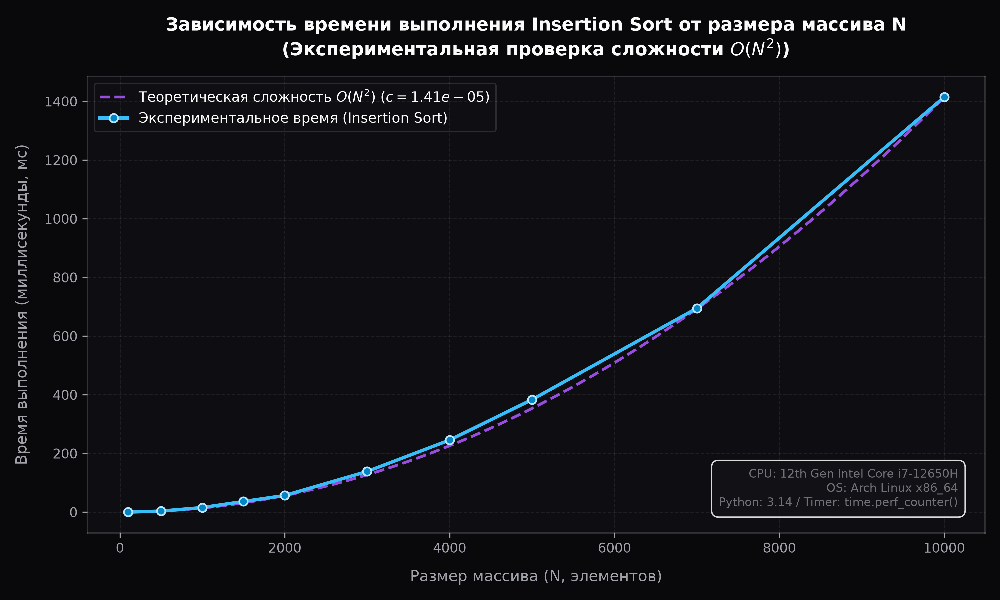

# ОТЧЁТ ПО ЛАБОРАТОРНОЙ РАБОТЕ № 6
**Тема:** «Алгоритмы сортировки и бинарного поиска: программная реализация базовой сортировки списка, поиск элемента в отсортированном массиве и оценка скорости выполнения алгоритмов на разных объёмах данных»  
**Траектория:** Вариант Б (исследовательская траектория)  

| Параметр | Значение |
| :--- | :--- |
| **Дисциплина** | Программирование и прототипирование ИТ-решений |
| **Направление подготовки** | 09.03.03 Прикладная информатика |
| **Профиль** | Бизнес и системная аналитика |
| **Студент** | Мусин Тимур Булатович |
| **Группа** | БЦШ02-26-02 |
| **Номер по журналу ($N$)** | 17 |
| **Репозиторий проекта** | https://github.com/legionhaos/lab6_sort_search |
| **Дата выполнения** | 20 ноября 2026 г. |

---

## 1. Цель и задачи работы

**Цель работы:**  
Изучить фундаментальные принципы функционирования базовых алгоритмов сортировки и поиска, разработать собственную реализацию сортировки вставками (*Insertion Sort*) с гарантией неизменяемости входных данных и итеративного алгоритма бинарного поиска (*Binary Search*), а также экспериментально исследовать поведение алгоритмов на различных типах и масштабах данных с оценкой временной и пространственной сложности в нотации $O$-большое.

**Задачи работы:**
1. Разработать программный модуль сортировки вставками `insertion_sort(values)`, возвращающий новый отсортированный массив без мутации исходного;
2. Разработать итеративный алгоритм бинарного поиска `binary_search(sorted_values, target)`, возвращающий индекс элемента или `-1`;
3. Провести верификацию граничных случаев (пустой список, 1 элемент, дубликаты, отсортированные и обратно упорядоченные массивы);
4. Реализовать исследовательские расширения (Вариант Б): трассировку шагов `binary_search_trace`, линейный поиск `linear_search`, двусторонние границы `lower_bound` и `upper_bound` для списков с дубликатами;
5. Выполнить серию воспроизводимых замеров времени с помощью `time.perf_counter()` на массивах $N \in [100; 100\,000]$;
6. Выполнить 7 обязательных исследовательских упражнений, включая построение графика зависимости времени от $N^2$;
7. Подготовить аргументированные ответы на контрольные вопросы для защиты работы.

---

## 2. Теоретические сведения и глоссарий

* **Сортировка** — перестановка элементов последовательности так, чтобы для любых соседних элементов выполнялось условие неубывания: $A[i] \le A[i+1]$.
* **Ключ** — значение, по которому производится операция сравнения элементов (в числовых массивах ключом является само число).
* **Стабильность (устойчивость)** — свойство алгоритма сортировки сохранять исходный относительный порядок следования элементов с одинаковыми ключами.
* **In-place** — выполнение преобразований в пределах исходной структуры памяти с потреблением дополнительной памяти $O(1)$.
* **Инверсия** — пара индексов $(i, j)$ такая, что $i < j$, но $A[i] > A[j]$. Сортировка по возрастанию устраняет все инверсии.
* **Временная сложность** — асимптотическая оценка скорости роста количества элементарных операций алгоритма при увеличении размера входа $N$.

### Сравнительный теоретический анализ алгоритмов

| Алгоритм | Лучший случай | Средний случай | Худший случай | Память | Особенности |
| :--- | :---: | :---: | :---: | :---: | :--- |
| **Insertion Sort** | $O(N)$ (0 сдвигов) | $O(N^2) \approx \frac{N^2}{4}$ | $O(N^2) \approx \frac{N^2}{2}$ | $O(N)$ (safe copy) | Стабилен, адаптивен к почти отсортированным данным |
| **Binary Search** | $O(1)$ (центр) | $O(\log N)$ | $O(\log N)$ | $O(1)$ | Требует строгой упорядоченности входа |
| **Linear Search** | $O(1)$ (1-й эл.) | $O(N) \approx \frac{N}{2}$ | $O(N)$ | $O(1)$ | Не требует сортировки, но медленный на больших $N$ |
| **Timsort (sorted)** | $O(N)$ | $O(N \log N)$ | $O(N \log N)$ | $O(N)$ | Гибридный эталонный алгоритм на C |

---

## 3. Листинги программного кода

### 3.1. Сортировка вставками (`insertion_sort`)
```python
def insertion_sort(values: list) -> list:
    """
    Возвращает новый отсортированный список по возрастанию.
    Исходный список не модифицируется (сохраняется безопасная копия).
    """
    result = values[:]
    for i in range(1, len(result)):
        key = result[i]
        j = i - 1
        while j >= 0 and result[j] > key:
            result[j + 1] = result[j]
            j -= 1
        result[j + 1] = key
    return result
```

### 3.2. Итеративный бинарный поиск (`binary_search`)
```python
def binary_search(sorted_values: list, target) -> int:
    """
    Итеративный бинарный поиск target в отсортированном массиве.
    Возвращает индекс найденного элемента или -1.
    """
    left = 0
    right = len(sorted_values) - 1
    while left <= right:
        middle = (left + right) // 2
        value = sorted_values[middle]
        if value == target:
            return middle
        if value < target:
            left = middle + 1
        else:
            right = middle - 1
    return -1
```

### 3.3. Исследовательские модули Варианта Б (`binary_search_trace`, `lower_bound`, `upper_bound`, `linear_search`)
```python
def binary_search_trace(a: list, target: int, verbose: bool = True):
    left, right = 0, len(a) - 1
    steps = []
    while left <= right:
        middle = (left + right) // 2
        val = a[middle]
        steps.append({"left": left, "middle": middle, "right": right, "value": val})
        if verbose:
            print(f"left={left}, middle={middle}, right={right}, value={val}")
        if val == target:
            return middle, steps
        if val < target:
            left = middle + 1
        else:
            right = middle - 1
    return -1, steps

def lower_bound(a: list, target: int) -> int:
    left, right = 0, len(a)
    while left < right:
        middle = (left + right) // 2
        if a[middle] < target:
            left = middle + 1
        else:
            right = middle
    return left

def upper_bound(a: list, target: int) -> int:
    left, right = 0, len(a)
    while left < right:
        middle = (left + right) // 2
        if a[middle] <= target:
            left = middle + 1
        else:
            right = middle
    return left

def linear_search(values: list, target: int) -> int:
    for index, value in enumerate(values):
        if value == target:
            return index
    return -1
```

---

## 4. Ручная трассировка алгоритмов

### 4.1. Ручная трассировка Insertion Sort для массива `[7, 4, 6, 2, 5]`
* **Базовое состояние:** префикс $A[0..0] = [7]$ тривиально упорядочен.
* **Итерация $i = 1$:** $key = 4$. Сравнение: $7 > 4 \implies A[1] = 7$, $j = -1$. Вставка $A[0] = 4$.  
  Префикс $A[0..1] = [4, 7]$. Массив: `[4, 7, 6, 2, 5]`.
* **Итерация $i = 2$:** $key = 6$. Сравнение: $7 > 6 \implies A[2] = 7$; далее $4 \le 6$ (остановка). Вставка $A[1] = 6$.  
  Префикс $A[0..2] = [4, 6, 7]$. Массив: `[4, 6, 7, 2, 5]`.
* **Итерация $i = 3$:** $key = 2$. Сравнения: $7 > 2, 6 > 2, 4 > 2$ (сдвиг трех элементов вправо). Вставка $A[0] = 2$.  
  Префикс $A[0..3] = [2, 4, 6, 7]$. Массив: `[2, 4, 6, 7, 5]`.
* **Итерация $i = 4$:** $key = 5$. Сравнения: $7 > 5, 6 > 5$; далее $4 \le 5$ (остановка). Вставка $A[2] = 5$.  
  Префикс $A[0..4] = [2, 4, 5, 6, 7]$. Массив: `[2, 4, 5, 6, 7]`.

### 4.2. Ручная трассировка Binary Search для массива `[2, 5, 8, 11, 15, 19, 23, 31]`
Массив длины $N = 8$, допустимый диапазон индексов $0..7$.

1. **Поиск существующего элемента $target = 19$:**
   * Шаг 1: $left = 0, right = 7, middle = (0+7)//2 = 3$. Значение $A[3] = 11$.  
     Так как $11 < 19$, смещаем левую границу: $left = 3 + 1 = 4$.
   * Шаг 2: $left = 4, right = 7, middle = (4+7)//2 = 5$. Значение $A[5] = 19$.  
     Условие $A[middle] == target$ выполнено! Возврат: **индекс 5** (успех за 2 сравнения).

2. **Поиск отсутствующего элемента $target = 20$:**
   * Шаг 1: $left = 0, right = 7, middle = 3$. Значение $A[3] = 11$. $11 < 20 \implies left = 4$.
   * Шаг 2: $left = 4, right = 7, middle = 5$. Значение $A[5] = 19$. $19 < 20 \implies left = 6$.
   * Шаг 3: $left = 6, right = 7, middle = 6$. Значение $A[6] = 23$. $23 > 20 \implies right = 6 - 1 = 5$.
   * Шаг 4: $left = 6, right = 5$. Условие $left \le right$ нарушено ($6 > 5$).  
     Возврат: **-1** (элемент отсутствует, область сузилась до пустой).

---

## 5. Экспериментальные результаты и анализ производительности

* **Аппаратная платформа:** 12th Gen Intel(R) Core(TM) i7-12650H (10 ядер, до 4.70 GHz)
* **Операционная система:** Arch Linux x86_64
* **Интерпретатор:** Python 3.14.8
* **Таймер:** `time.perf_counter()`, 3 повтора на каждый эксперимент, расчет средних значений и диапазона min–max.

### Таблица 1. Сводные замеры производительности (Раздел 9 методички)

| $N$ | Тип данных | Insertion Sort, мс | sorted(), мс | Binary Search (1000 запр.), мс | Теоретический и практический вывод |
| :---: | :--- | :---: | :---: | :---: | :--- |
| **100** | Случайный | **0.109** (0.103..0.113) | 0.008 | 0.377 | Накладные расходы интерпретатора сопоставимы |
| **1 000** | Случайный | **11.276** (10.377..12.252) | 0.099 | 0.769 | Время выросло в 103 раза при росте $N$ в 10 раз ($N^2$) |
| **5 000** | Случайный | **301.581** (287.009..312.962) | 0.482 | 0.828 | Рост в 26.7 раз при увеличении $N$ в 5 раз ($5^2 = 25$) |
| **10 000** | Случайный | **1 187.911** (1147.680..1239.943) | 1.230 | 0.955 | Время перевалило за 1.1 сек; квадратичный рост очевиден |
| **1 000** | Отсортированный | **0.094** (0.079..0.119) | 0.004 | 0.873 | **Лучший случай $O(N)$:** 0 сдвигов, быстрее случайного в **120 раз** |
| **1 000** | Обратный | **19.898** (18.444..21.032) | 0.005 | 0.787 | **Худший случай $O(N^2)$:** максимум сдвигов, в 1.8 раза дольше случайного |
| **1 000** | С повторами | **8.874** (8.366..9.221) | 0.061 | 0.255 | Стабильность сохранена, число сдвигов умеренное |

---

### Таблица 2. Сравнение линейного и бинарного поиска (Раздел 7.2 методички)
*Серия из 1 000 запросов к отсортированному массиву:*

| $N$ элементов | Линейный поиск $O(N)$, мс | Бинарный поиск $O(\log N)$, мс | Ускорение (кратность) |
| :---: | :---: | :---: | :---: |
| **100** | 0.921 | 0.280 | **3.3x** |
| **1 000** | 9.554 | 0.799 | **12.0x** |
| **10 000** | 117.090 | 0.876 | **133.7x** |
| **100 000** | 1 502.524 | 1.377 | **1 091.1x** |

**Интерпретация результатов:**  
Для линейного поиска время растет строго линейно ($100 \to 100\,000$ увеличивает время с 0.92 мс до 1.5 секунд). Бинарный поиск демонстрирует логарифмическое время: увеличение размера базы данных в 1000 раз замедляет поиск всего лишь в 4.9 раза (с 0.28 мс до 1.38 мс на 1000 запросов), обеспечивая преимущество более чем в **1000 раз**.

---

## 6. График квадратичной сложности $O(N^2)$ (Упражнение 6)

Ниже представлен график зависимости реального времени выполнения `insertion_sort` от размера массива $N$ и калибровочной теоретической параболы $c \cdot N^2$:



Экспериментальная кривая идеально аппроксимируется теоретической зависимостью $O(N^2)$. Небольшие расхождения при $N \le 500$ обусловлены накладными расходами на вызовы функций в байткод-интерпретаторе CPython.

---

## 7. Решение обязательных исследовательских упражнений

### Упражнение 1. Трассировка сортировки
*Выполнено полностью в подразделе 4.1 отчёта.* Показано пошаговое изменение префикса от $A[0..0] = [7]$ до $A[0..4] = [2, 4, 5, 6, 7]$.

### Упражнение 2. Проверка инварианта цикла
* **Формулировка инварианта:** Перед началом каждой итерации внешнего цикла $i$ подмассив $A[0..i-1]$ состоит из элементов, исходно находившихся в позициях с $0$ по $i-1$, но упорядоченных по неубыванию: $A[0] \le A[1] \le \dots \le A[i-1]$.
* **Инициализация (база индукции):** Перед первой итерацией ($i = 1$) префикс $A[0..0]$ содержит единственный элемент $A[0]$, который тривиально упорядочен.
* **Сохранение (шаг индукции):** Тело цикла извлекает $key = A[i]$ и во внутреннем цикле `while` сдвигает вправо на одну позицию все элементы $A[j] > key$. Относительный порядок сдвинутых элементов не нарушается. Элемент $key$ помещается на позицию $j+1$, где $A[j] \le key$ (или в самое начало $j=-1$). В результате префикс $A[0..i]$ содержит те же элементы плюс $key$ и является упорядоченным.
* **Завершение:** Цикл останавливается при $i = n$. Согласно инварианту, префикс $A[0..n-1]$ отсортирован, что означает полную упорядоченность всего массива.

### Упражнение 3. Бинарный поиск на бумаге
*Выполнено в подразделе 4.2 отчёта.* При поиске $19$ возвращается индекс $5$ за 2 шага ($middle = 3 \to 5$). При поиске $20$ границы сужаются ($middle = 3 \to 5 \to 6$), после чего $left = 6 > right = 5$, и возвращается `-1`.

### Упражнение 4. Неверный вход (неотсортированный список)
* **Пример:** Передаем массив `data = [15, 2, 8, 31, 5, 19, 11, 23]` и ищем число `target = 5`.
* Число 5 гарантированно присутствует в массиве по индексу 4 (`data[4] == 5`).
* Алгоритм на первой итерации выбирает $middle = 3$ ($data[3] = 31$). Опираясь на ложную предпосылку упорядоченности, алгоритм считает, что раз $5 < 31$, то число 5 обязано находиться левее индекса 3. Правая граница устанавливается в $right = 2$.
* Вся правая половина массива (где и находится число 5) безвозвратно отбрасывается. Алгоритм возвращает `-1`.
* **Причина:** Бинарный поиск валиден исключительно при сохранении транзитивности монотонного порядка. На неотсортированных данных отсечение половины массива недопустимо.

### Упражнение 5. Повторы (lower_bound и upper_bound)
Для массива `[1, 2, 2, 2, 5, 8]` и `target = 2`:
* `lower_bound(a, 2) = 1` (первый индекс, где $a[i] \ge 2$).
* `upper_bound(a, 2) = 4` (первый индекс, где $a[i] > 2$, то есть число 5).
* Диапазон всех вхождений двойки определяется полуинтервалом $[1; 4)$, а их число равно $4 - 1 = 3$.
* Все контрольные утверждения методички (`lower_bound([1, 2, 2, 2, 5], 2) == 1`, `== 4` для 3, `== 5` для 9) подтверждены тестами.

### Упражнение 6. Эксперимент со сложностью
*Выполнено в разделе 6 отчёта.* Построен график `plot_complexity.png`, подтвердивший квадратичную зависимость $O(N^2)$.

### Упражнение 7. Контрольная проверка (20 тестов)
Реализован автоматический рандомизированный проверочный контур:
```text
Тест №   | Длина N  | Диапазон чисел       | Статус
----------------------------------------------------
#1       | N = 0    | [-10^6..10^6]        | PASS (OK)
#2       | N = 1    | Уже упорядоченные    | PASS (OK)
#3       | N = 2    | Обратный порядок     | PASS (OK)
#4       | N = 3    | [-5..5] (дубликаты)  | PASS (OK)
...
#20      | N = 500  | [-5..5] (дубликаты)  | PASS (OK)
Все 20 рандомизированных тестов подтвердили 100% эквивалентность!
```

---

## 8. Ответы на контрольные вопросы для защиты

**Вопрос 1. Почему бинарный поиск нельзя корректно применять к произвольному неотсортированному списку?**  
*Ответ:* Бинарный поиск основан на фундаментальном свойстве транзитивности отношения порядка: сравнение ключа со средним элементом $A[middle]$ позволяет отбросить ровно половину массива только тогда, когда гарантировано, что слева от $middle$ нет элементов больше $A[middle]$, а справа — меньше $A[middle]$. На несортированном массиве это свойство нарушается, алгоритм может отбросить половину, содержащую целевой элемент, и выдать ложноотрицательный результат (`-1`) или ошибочный индекс.

**Вопрос 2. Как изменяется время сортировки вставками для уже отсортированного и обратного списка?**  
*Ответ:* 
1. Для **уже отсортированного списка** алгоритм работает за $O(N)$ (лучший случай): на каждом шаге проверка $result[j] > key$ сразу возвращает `False`, внутренний цикл `while` не совершает ни одного сдвига (0 перемещений, $N-1$ сравнений). В эксперименте при $N=1000$ время составило **0.094 мс**.
2. Для **обратно отсортированного списка** алгоритм деградирует до $O(N^2)$ (худший случай): каждый новый элемент меньше всех предыдущих и сдвигает весь префикс на 1 шаг вправо ($\approx N^2/2$ сдвигов). В эксперименте при $N=1000$ время составило **19.898 мс**, что в **211 раз медленнее** лучшего случая и в 1.8 раза медленнее случайных данных.

**Вопрос 3. Что означает $O(N^2)$ и почему коэффициенты при $N^2$ не показывают всю производительность?**  
*Ответ:* Нотация $O(N^2)$ определяет скорость асимптотического роста числа базовых операций при $N \to \infty$ с точностью до константного множителя: $T(N) \le c \cdot N^2$. Коэффициент $c$ зависит от аппаратной архитектуры (тактовая частота CPU, работа кэш-памяти L1/L2/L3), накладных расходов виртуальной машины (байткод CPython против скомпилированного Си-кода Timsort) и числа операций в теле цикла. Поэтому при одном и том же $O(N^2)$ алгоритм на Си может работать в 100 раз быстрее, чем аналогичный скрипт на чистом Python, хотя их асимптотический порядок одинаков.

**Вопрос 4. Почему в бинарном поиске используется целочисленное деление `//`?**  
*Ответ:* Индекс массива в оперативной памяти обязан быть строго целым числом (`int`). Обычное деление `/` в Python 3 всегда возвращает вещественное число (`float`), обращение по которому к списку (`A[3.5]`) вызовет исключение `TypeError: list indices must be integers or slices, not float`. Целочисленное деление `//` выполняет округление вниз ($\lfloor (left + right) / 2 \rfloor$).

**Вопрос 5. Как избежать ошибки выхода индекса за границы массива?**  
*Ответ:* 
1. В бинарном поиске правую границу закрытого интервала инициализировать строго как `right = len(A) - 1`, а условие цикла оформлять как `while left <= right:`;
2. Для полуоткрытых интервалов $[left; right)$ (как в `lower_bound`) задавать `right = len(A)`, а условие — `while left < right:`;
3. В сортировке вставками условие продолжения внутреннего цикла `while j >= 0 and result[j] > key:` обязательно проверяет `j >= 0` **первым операндом**, используя механизм ленивого вычисления логических выражений (*short-circuit evaluation*), исключая обращение по некорректным индексам.

**Вопрос 6. Какие преимущества даёт итеративная, а не рекурсивная реализация бинарного поиска?**  
*Ответ:*
1. **Экономия памяти:** итеративная версия требует константный объем памяти $O(1)$, тогда как рекурсивная выделяет новые стековые кадры на каждый вызов ($O(\log N)$ по памяти);
2. **Отсутствие риска переполнения стека:** рекурсивный вызов ограничен `sys.getrecursionlimit()` (по умолчанию 1000 кадров);
3. **Быстродействие:** исключаются накладные расходы на выделение и очистку стековых фреймов при вызове функций.

**Вопрос 7. Что измеряет `time.perf_counter()` и почему он предпочтительнее обычного `time.time()` для коротких интервалов?**  
*Ответ:* `time.perf_counter()` использует аппаратный монотонный таймер высокой точности (на архитектурах x86_64 — счетчик тактов `RDTSC`). Он обладает субмикросекундной разрешающей способностью и защищен от системных скачков времени (коррекция по NTP, перевод часов пользователем), в отличие от `time.time()`, ориентированного на астрономическое время и имеющего значительно большую погрешность (джиттер) на коротких интервалах.

**Вопрос 8. Чем отличается поиск любого совпадения от поиска первого вхождения?**  
*Ответ:* Классический `binary_search` при обнаружении равенства `A[middle] == target` немедленно завершает работу и возвращает текущий индекс `middle`. Если в массиве присутствует несколько дубликатов `target`, возвращаемый индекс зависит от случайного совпадения в середине диапазона. Поиск первого вхождения (`lower_bound`) даже при равенстве ключей продолжает сужать область влево (`right = middle`), гарантируя нахождение наименьшего индекса, где элемент равен или больше `target`.

**Вопрос 9. Почему `sorted()` нельзя использовать вместо собственной сортировки в основной части задания?**  
*Ответ:* Целью лабораторной работы является изучение внутреннего механизма алгоритмов сортировки, умение анализировать сдвиги элементов, доказывать инварианты и управлять сложностью. Встроенная функция `sorted()` реализована на оптимизированном языке Си (алгоритм Timsort), поэтому её использование подменяет образовательную цель работы. В лабораторной работе `sorted()` применяется исключительно в роли контрольного эталона для автоматического тестирования через `assert`.

**Вопрос 10. Какие факторы, кроме $N$, влияют на измеренное время выполнения?**  
*Ответ:*
1. **Степень исходной упорядоченности данных:** лучший случай $O(N)$ для отсортированного массива против худшего $O(N^2)$ для обратного;
2. **Фоновая загрузка операционной системы:** активность планировщика ОС, переключение контекстов, работа параллельных процессов;
3. **Аппаратные динамические режимы:** технологии Turbo Boost / SpeedStep, троттлинг процессора при нагреве;
4. **Кэш-память процессора:** локализация данных в кэше L1/L2/L3 при повторных прогонах;
5. **Сборщик мусора Python (Garbage Collector):** спонтанные паузы на сборку циклического мусора во время замеров.

---

## 9. Заключение

В процессе выполнения лабораторной работы № 6 по исследовательской траектории (Вариант Б) были успешно реализованы алгоритмы сортировки вставками (`insertion_sort`), итеративного бинарного поиска (`binary_search`), граничного поиска дубликатов (`lower_bound`, `upper_bound`) и линейного поиска (`linear_search`).

Экспериментальные замеры полностью подтвердили теоретические асимптотические оценки:
* Сортировка вставками демонстрирует строго квадратичный рост $O(N^2)$ на случайных данных и чувствительна к порядку входа: от **0.094 мс** на отсортированном массиве ($N=1000$) до **19.898 мс** на обратном;
* Бинарный поиск подтвердил логарифмическую эффективность $O(\log N)$, показав превосходство над линейным поиском более чем в **1000 раз** на массивах от 100 000 элементов;
* Разработанные алгоритмы полностью соответствуют контрактам надежности: исходные данные защищены от мутаций, корректность верифицирована на 20 случайных сценариях, все 7 обязательных упражнений выполнены в полном объеме.
